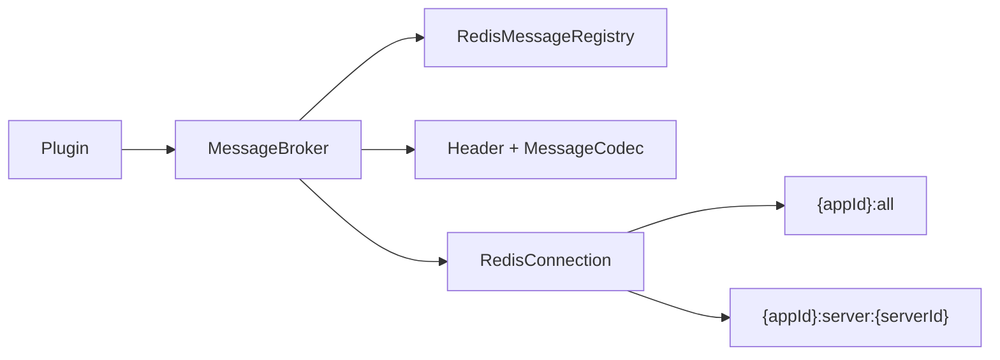

# Sparrow Message

English | [简体中文](README_CN.md)

Sparrow Message is a lightweight messaging library built for Minecraft server networks. It sits on top of Redis Pub/Sub and gives you typed one-way messages and request/response calls between servers, with a binary wire format you control.

It requires Java 21. Redis 6+ or Valkey works as the backend.

## Features

- One-way messages to every server, every other server, one server, or all servers carrying a tag.
- Request/response between two servers, returned as a `CompletableFuture`, with a default timeout and a per-call override.
- Fast failure: a request to an offline server fails immediately, and a failure in the remote handler is reported back to the caller.
- Messages addressed to the local server are handled in place, without touching Redis.
- Handlers run on virtual threads by default. Messages that must be handled in order share a serial executor.
- Serialization is yours: each message reads and writes a Netty `ByteBuf` directly.
- Several brokers can share one Redis connection, one per feature of your plugin.
- No dependencies beyond Lettuce and the Netty that ships with your platform.

## Architecture



```text
src/main/java/net/momirealms/sparrow/message
+-- MessageBroker            Main API and its Builder
+-- RedisMessage             Base interface of every message
+-- MessageIdentifier        Name of a message type
+-- Target                   Where a one-way message goes
+-- Logger                   Log sink you implement
+-- message                  OneWayMessage, TwoWayRequestMessage, TwoWayResponseMessage
+-- codec                    MessageCodec and its encoder / decoder halves
+-- registry                 Message registration and wire id assignment
+-- connection               RedisConnection and the Lettuce implementation
+-- executors                Virtual-thread executor and serial executors
+-- exception                NoSubscriberException, RemoteMessageException
+-- util                     ByteBufHelper
```

A `MessageBroker` is identified by an `appId` and a `serverId`. Brokers with the same `appId` talk to each other, and every broker subscribes to two channels:

| Channel | Carries |
|---|---|
| `{appId}:all` | Broadcasts and tag-targeted messages |
| `{appId}:server:{serverId}` | Messages, requests and responses addressed to that server |

Every payload starts with a small header written by the library, followed by the body written by the message's codec:

```text
byte    flags            bits 0-1: kind (one-way, request, response, error), bit 2: has tag, bit 3: exclude source
varint  type id          assigned by registration order; absent on error responses
utf8    tag              only when bit 2 is set
utf8    source server    only when bit 3 is set or the kind is request
long    correlation id   absent on one-way messages
...     body
```

A plain broadcast costs two bytes of header. Tag and source filtering happen right after the header is read, so a server that is not a recipient never decodes the body.

## Getting started

### Dependency

```kotlin
repositories {
    mavenCentral()
    maven("https://repo.momirealms.net/releases/")
}

dependencies {
    implementation("net.momirealms:sparrow-message:26.11")
    implementation("io.lettuce:lettuce-core:7.7.0.RELEASE")
}
```

The library declares Lettuce as `compileOnly`, so you provide it yourself. Netty comes from your platform (Paper, Velocity and BungeeCord all ship it) or transitively from Lettuce. Relocate `net.momirealms.sparrow.message` when you shade it into a plugin.

### Create a broker

```java
RedisClient client = RedisClient.create("redis://127.0.0.1:6379");
RedisConnection connection = new LettuceRedisConnection(client);

MessageBroker broker = MessageBroker.builder()
        .appId("myplugin:chat")
        .serverId("survival-1")
        .tags(Set.of("survival"))
        .connection(connection)
        .logger(myLogger)
        .requestTimeout(Duration.ofSeconds(10))   // optional, 10 seconds by default
        .build();
```

`appId` is used verbatim as the channel prefix. Redis channels are global to the whole instance, regardless of the selected database, so write it as `plugin:feature` and add an environment segment if several networks share one Redis.

Register every message, then subscribe:

```java
broker.registry().register(HelloMessage.ID, HelloMessage.CODEC);
broker.registry().register(PlayerCountRequest.ID, PlayerCountRequest.CODEC);
broker.registry().register(PlayerCountResponse.ID, PlayerCountResponse.CODEC);
broker.subscribe();
```

On shutdown:

```java
broker.unsubscribe();
connection.close();
client.shutdown();
```

The connection belongs to whoever created it. Several brokers may share one `RedisConnection`; closing it is your job, not the broker's.

### Define a one-way message

```java
public final class HelloMessage extends OneWayMessage {
    public static final MessageIdentifier ID = MessageIdentifier.of("myplugin", "hello");
    public static final MessageCodec<HelloMessage> CODEC = MessageCodec.of(HelloMessage::write, HelloMessage::new);

    private final String text;

    public HelloMessage(String text) {
        this.text = text;
    }

    private HelloMessage(ByteBuf buffer) {
        this.text = ByteBufHelper.readUtf8(buffer);
    }

    private void write(ByteBuf buffer) {
        ByteBufHelper.writeUtf8(buffer, this.text);
    }

    @NotNull
    @Override
    public MessageIdentifier identifier() {
        return ID;
    }

    @Override
    public void handle() {
        System.out.println("Received: " + this.text);
    }
}
```

`handle()` runs on the receiving server. The constructor that takes a `ByteBuf` and the `write` method only deal with the message's own fields; routing information lives in the header.

To read and write through another buffer type, such as Minecraft's `FriendlyByteBuf`, pass a wrapper:

```java
MessageCodec<HelloMessage> CODEC = MessageCodec.of(FriendlyByteBuf::new, HelloMessage::write, HelloMessage::new);
```

### Send one-way messages

```java
broker.publishAll(new HelloMessage("to everyone"));                           // every server, including this one
broker.publishOthers(new HelloMessage("to everyone else"));                   // every server except this one
broker.publish(new HelloMessage("to one server"), "survival-2");              // one server
broker.publish(new HelloMessage("to tagged servers"), Target.tag("survival")); // servers carrying the tag
```

Each call returns a `CompletableFuture<Long>` that completes once Redis has accepted the message. The value is the number of subscriber connections that received it. Zero is still a success, and the future does not wait for the remote handler.

```java
broker.publish(new HelloMessage("hi"), "survival-2")
        .thenAccept(receivers -> System.out.println("delivered to " + receivers + " subscriber(s)"));
```

### Request and response

A request names its response type and produces it in `handleRequest()`:

```java
public final class PlayerCountRequest extends TwoWayRequestMessage<PlayerCountResponse> {
    public static final MessageIdentifier ID = MessageIdentifier.of("myplugin", "player_count_request");
    public static final MessageCodec<PlayerCountRequest> CODEC = MessageCodec.of(PlayerCountRequest::write, PlayerCountRequest::new);

    private final String world;

    public PlayerCountRequest(String world) {
        this.world = world;
    }

    private PlayerCountRequest(ByteBuf buffer) {
        this.world = ByteBufHelper.readUtf8(buffer);
    }

    private void write(ByteBuf buffer) {
        ByteBufHelper.writeUtf8(buffer, this.world);
    }

    @NotNull
    @Override
    public MessageIdentifier identifier() {
        return ID;
    }

    @NotNull
    @Override
    public CompletableFuture<PlayerCountResponse> handleRequest() {
        // this.sourceServer() is the server that sent the request
        return CompletableFuture.completedFuture(new PlayerCountResponse(42));
    }
}

public final class PlayerCountResponse extends TwoWayResponseMessage {
    public static final MessageIdentifier ID = MessageIdentifier.of("myplugin", "player_count_response");
    public static final MessageCodec<PlayerCountResponse> CODEC = MessageCodec.of(PlayerCountResponse::write, PlayerCountResponse::new);

    private final int count;

    public PlayerCountResponse(int count) {
        this.count = count;
    }

    private PlayerCountResponse(ByteBuf buffer) {
        this.count = ByteBufHelper.readCompactInt(buffer);
    }

    private void write(ByteBuf buffer) {
        ByteBufHelper.writeCompactInt(buffer, this.count);
    }

    public int count() {
        return this.count;
    }

    @NotNull
    @Override
    public MessageIdentifier identifier() {
        return ID;
    }
}
```

The future returned by `handleRequest()` may complete later and on any thread; the broker sends the response when it does.

```java
broker.publishTwoWay(new PlayerCountRequest("world"), "survival-2")
        .thenAccept(response -> System.out.println("players: " + response.count()));
```

Pass a timeout for calls that need more or less time than the default. It is measured from the moment of the call:

```java
broker.publishTwoWay(new PlayerCountRequest("world"), "survival-2", Duration.ofSeconds(30))
        .whenComplete((response, error) -> {
            if (error == null) {
                System.out.println("players: " + response.count());
                return;
            }
            Throwable cause = error instanceof CompletionException ? error.getCause() : error;
            if (cause instanceof NoSubscriberException) {
                System.out.println("target is offline");
            } else if (cause instanceof TimeoutException) {
                System.out.println("no response in time");
            } else if (cause instanceof RemoteMessageException remote) {
                System.out.println("target failed: " + remote.exceptionClass() + " " + remote.exceptionMessage());
            }
        });
```

| The future fails with | When |
|---|---|
| `NoSubscriberException` | The target server is not subscribed, usually because it is offline. Fails at once. |
| `java.util.concurrent.TimeoutException` | No response arrived in time. The remote side is not cancelled and a late response is ignored. |
| `RemoteMessageException` | `handleRequest()` threw or its future failed. Carries the exception class name and message; the full stack trace is logged on the handling server. |
| `IllegalStateException` | The broker unsubscribed while waiting. |

A `handleRequest()` future that completes with `null` sends no response, and the caller runs into its timeout.

### Threads and ordering

- Handlers run on the executor returned by the message's `executor()`. The default is `MessageExecutors.VIRTUAL`, one virtual thread per message, so a handler may block.
- Futures returned by the broker complete on a virtual thread as well, never on the Redis I/O thread. Callbacks attached to them may block.
- Messages that must be handled in arrival order return the same serial executor:

```java
private static final Executor ORDERED = MessageExecutors.newSerialExecutor();

@NotNull
@Override
public Executor executor() {
    return ORDERED;
}
```

A serial executor runs one task at a time, in submission order. Ordering covers the handler up to the point it returns; work it hands off elsewhere is yours to coordinate. Use a separate serial executor for each group of messages, so one slow group does not hold up another.

### Local delivery

A message or request addressed to the local `serverId` skips Redis and serialization entirely: the handler receives the very object you passed in, on the message's executor. Timeouts and failure rules stay the same.

Broadcasts and tag targets that include the local server still travel through Redis, so every server observes them in the same order.

To send a server-addressed message through Redis even when the target is the local `serverId`, for example to reach another process that uses the same id, override:

```java
@Override
public boolean shortCircuitLocally() {
    return false;
}
```

## Things to know

- **Registration order is the wire format.** Type ids are assigned in registration order. Every broker with the same `appId` must register the same messages in the same order, before subscribing. Adding a message in the middle requires updating all servers together.
- **A message must be registered before it is published**, and so must the response type of a request.
- **Delivery is at most once.** Redis Pub/Sub does not store messages. A server that is offline or disconnected misses whatever is published meanwhile.
- **`publishOthers` counts the local subscription too.** Redis still delivers the message to the sending server, which then discards it.
- **Handler failures go to your `Logger`.** An exception thrown by `handle()`, a payload that fails to decode, and a failed `handleRequest()` are all reported through `Logger.error`.
- **Messages with an unknown type id are dropped silently.**