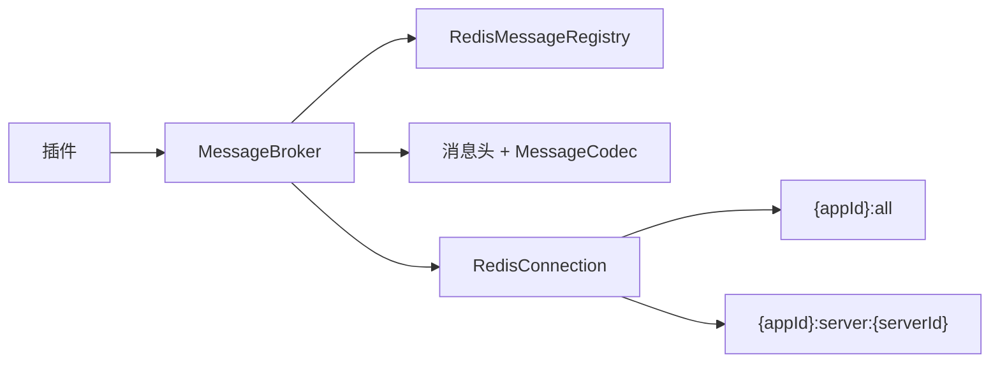

# Sparrow Message

[English](README.md) | 简体中文

Sparrow Message 是专为 Minecraft 服务器集群设计的轻量消息库。它建立在 Redis Pub/Sub 之上，提供服务器之间的类型化单向消息和请求响应调用，线上格式是由你自己控制的二进制数据。

需要 Java 21。后端可以用 Redis 6+ 或 Valkey。

## 功能

- 单向消息可以发给所有服务器、除自己以外的所有服务器、指定服务器，或带有某个 tag 的所有服务器。
- 两台服务器之间的请求响应，以 `CompletableFuture` 返回，有默认超时，单次调用可以另行指定。
- 快速失败：发给不在线服务器的请求立即失败，对端处理逻辑出错时把错误带回给调用方。
- 发给本服的消息直接在本地处理，不经过 Redis。
- 处理逻辑默认直接运行在 Redis 的 I/O 线程上，按到达顺序处理，没有调度开销。需要阻塞的消息可以改用虚拟线程。
- 可以把消息编码成频道名和字节，写进 Lua 脚本和别的 Redis 写入一起原子发布。
- 序列化由你决定：每个消息直接读写 Netty 的 `ByteBuf`。
- 多个 broker 可以共用一条 Redis 连接，插件的每个功能各用一个。
- 除了 Lettuce 和平台自带的 Netty 之外没有其他依赖。

## 项目架构



```text
src/main/java/net/momirealms/sparrow/message
+-- MessageBroker            主要 API 及其 Builder
+-- RedisMessage             所有消息的基础接口
+-- MessageIdentifier        消息类型的名字
+-- Target                   单向消息的发送目标
+-- PreparedMessage          编码好的单向消息, 供 Lua 脚本发布
+-- Logger                   由你实现的日志出口
+-- message                  OneWayMessage、TwoWayRequestMessage、TwoWayResponseMessage
+-- codec                    MessageCodec 及其编码、解码两半
+-- registry                 消息注册与线上类型 ID 分配
+-- connection               RedisConnection 与 Lettuce 实现
+-- executors                直接执行、虚拟线程与串行执行器
+-- exception                NoSubscriberException、RemoteMessageException
+-- util                     ByteBufHelper
```

一个 `MessageBroker` 由 `appId` 和 `serverId` 标识。`appId` 相同的 broker 之间互相通信，每个 broker 订阅两个频道：

| 频道 | 承载的内容 |
|---|---|
| `{appId}:all` | 广播消息和按 tag 发送的消息 |
| `{appId}:server:{serverId}` | 发给这台服务器的消息、请求和响应 |

每条数据以库写入的一小段消息头开始，后面是消息的 codec 写入的消息体：

```text
byte    标记位          bit 0-1: 种类 (单向, 请求, 响应, 错误), bit 2: 带 tag, bit 3: 排除来源
int     类型 ID         默认是消息标识的 hash, 定长 4 字节; 错误响应没有
utf8    tag             bit 2 置位时才有
utf8    来源服务器       bit 3 置位或种类为请求时才有
long    关联 ID         单向消息没有
...     消息体
```

普通广播的消息头占 5 个字节。类型 ID 的分配方式可以在创建 broker 时改成按注册顺序，那样类型 ID 是 varint，普通广播的消息头只占 2 个字节，见[注意事项](#注意事项)。tag 和来源的过滤在读完消息头后立即进行，不是接收方的服务器不会解码消息体。

## 快速开始

库把 Lettuce 声明为 `compileOnly`，需要你自己提供。Netty 来自你的平台（Paper、Velocity、BungeeCord 都自带），或者由 Lettuce 传递引入。把库打进插件时请重定位 `net.momirealms.sparrow.message`。

### 创建 Broker

```java
RedisClient client = RedisClient.create("redis://127.0.0.1:6379");
RedisConnection connection = new LettuceRedisConnection(client);

MessageBroker broker = MessageBroker.builder()
        .appId("myplugin:chat")
        .serverId("survival-1")
        .tags(Set.of("survival"))
        .connection(connection)
        .logger(myLogger)
        .requestTimeout(Duration.ofSeconds(10))   // 可选, 默认 10 秒
        .typeIdStrategy(TypeIdStrategy.IDENTIFIER_HASH)   // 可选, 默认 IDENTIFIER_HASH
        .build();
```

`appId` 原样作为频道名前缀。Redis 的频道在整个实例内全局可见，和选择的数据库编号无关，所以建议写成 `插件名:功能名`；多组服务器共用一个 Redis 时再加一段环境标识。

先注册所有消息，再订阅：

```java
broker.registry().register(HelloMessage.ID, HelloMessage.CODEC);
broker.registry().register(PlayerCountRequest.ID, PlayerCountRequest.CODEC);
broker.registry().register(PlayerCountResponse.ID, PlayerCountResponse.CODEC);
broker.subscribe();
```

关闭时：

```java
broker.unsubscribe();
connection.close();
client.shutdown();
```

连接归创建它的一方所有。多个 broker 可以共用一个 `RedisConnection`，关闭它是你的事，broker 不会代劳。

### 定义单向消息

```java
public final class HelloMessage extends OneWayMessage {
    public static final MessageIdentifier ID = MessageIdentifier.of("myplugin", "hello");
    public static final MessageCodec<HelloMessage> CODEC = MessageCodec.of(HelloMessage::write, HelloMessage::new);

    private final String text;

    public HelloMessage(String text) {
        this.text = text;
    }

    private HelloMessage(ByteBuf buffer) {
        this.text = ByteBufHelper.readUtf8(buffer);
    }

    private void write(ByteBuf buffer) {
        ByteBufHelper.writeUtf8(buffer, this.text);
    }

    @NotNull
    @Override
    public MessageIdentifier identifier() {
        return ID;
    }

    @Override
    public void handle() {
        System.out.println("Received: " + this.text);
    }
}
```

`handle()` 在收到消息的服务器上运行。接收 `ByteBuf` 的构造器和 `write` 方法只处理消息自己的字段，路由信息在消息头里。

想用别的缓冲区类型读写，例如 Minecraft 的 `FriendlyByteBuf`，传入一个包装函数：

```java
MessageCodec<HelloMessage> CODEC = MessageCodec.of(FriendlyByteBuf::new, HelloMessage::write, HelloMessage::new);
```

### 发送单向消息

```java
broker.publishAll(new HelloMessage("to everyone"));                           // 所有服务器, 包含本服
broker.publishOthers(new HelloMessage("to everyone else"));                   // 除本服以外的所有服务器
broker.publish(new HelloMessage("to one server"), "survival-2");              // 指定服务器
broker.publish(new HelloMessage("to tagged servers"), Target.tag("survival")); // 带有该 tag 的服务器
```

每个方法都返回 `CompletableFuture<Long>`，在 Redis 接受消息后完成。值是收到这条消息的订阅连接数量，0 也算成功；Future 不等待对端的处理逻辑。

```java
broker.publish(new HelloMessage("hi"), "survival-2")
        .thenAccept(receivers -> System.out.println("delivered to " + receivers + " subscriber(s)"));
```

### 请求与响应

请求声明自己的响应类型，并在 `handleRequest()` 里给出响应：

```java
public final class PlayerCountRequest extends TwoWayRequestMessage<PlayerCountResponse> {
    public static final MessageIdentifier ID = MessageIdentifier.of("myplugin", "player_count_request");
    public static final MessageCodec<PlayerCountRequest> CODEC = MessageCodec.of(PlayerCountRequest::write, PlayerCountRequest::new);

    private final String world;

    public PlayerCountRequest(String world) {
        this.world = world;
    }

    private PlayerCountRequest(ByteBuf buffer) {
        this.world = ByteBufHelper.readUtf8(buffer);
    }

    private void write(ByteBuf buffer) {
        ByteBufHelper.writeUtf8(buffer, this.world);
    }

    @NotNull
    @Override
    public MessageIdentifier identifier() {
        return ID;
    }

    @NotNull
    @Override
    public CompletableFuture<PlayerCountResponse> handleRequest() {
        // this.sourceServer() 是发起请求的服务器
        return CompletableFuture.completedFuture(new PlayerCountResponse(42));
    }
}

public final class PlayerCountResponse extends TwoWayResponseMessage {
    public static final MessageIdentifier ID = MessageIdentifier.of("myplugin", "player_count_response");
    public static final MessageCodec<PlayerCountResponse> CODEC = MessageCodec.of(PlayerCountResponse::write, PlayerCountResponse::new);

    private final int count;

    public PlayerCountResponse(int count) {
        this.count = count;
    }

    private PlayerCountResponse(ByteBuf buffer) {
        this.count = ByteBufHelper.readCompactInt(buffer);
    }

    private void write(ByteBuf buffer) {
        ByteBufHelper.writeCompactInt(buffer, this.count);
    }

    public int count() {
        return this.count;
    }

    @NotNull
    @Override
    public MessageIdentifier identifier() {
        return ID;
    }
}
```

`handleRequest()` 返回的 Future 可以稍后在任意线程完成，broker 等它完成后再把响应发回去。

```java
broker.publishTwoWay(new PlayerCountRequest("world"), "survival-2")
        .thenAccept(response -> System.out.println("players: " + response.count()));
```

耗时和默认值不同的调用可以传入超时时间，从调用的那一刻开始计时：

```java
broker.publishTwoWay(new PlayerCountRequest("world"), "survival-2", Duration.ofSeconds(30))
        .whenComplete((response, error) -> {
            if (error == null) {
                System.out.println("players: " + response.count());
                return;
            }
            Throwable cause = error instanceof CompletionException ? error.getCause() : error;
            if (cause instanceof NoSubscriberException) {
                System.out.println("target is offline");
            } else if (cause instanceof TimeoutException) {
                System.out.println("no response in time");
            } else if (cause instanceof RemoteMessageException remote) {
                System.out.println("target failed: " + remote.exceptionClass() + " " + remote.exceptionMessage());
            }
        });
```

| Future 的失败原因 | 发生条件 |
|---|---|
| `NoSubscriberException` | 目标服务器没有订阅，通常是不在线。立即失败。 |
| `java.util.concurrent.TimeoutException` | 没有在规定时间内收到响应。对端不会被取消，迟到的响应被忽略。 |
| `RemoteMessageException` | `handleRequest()` 抛出异常或它的 Future 失败。带有异常类名和消息文本，完整堆栈记录在处理端的日志里。 |
| `IllegalStateException` | 等待期间 broker 退订了。 |

`handleRequest()` 的 Future 以 `null` 完成时不发送响应，调用方会等到超时。

### 线程与顺序

处理逻辑运行在消息的 `executor()` 返回的执行器上。

| 执行器 | 处理逻辑运行在 | 适用情况 |
|---|---|---|
| `MessageExecutors.SYNC`（默认） | Redis 的 I/O 线程，按到达顺序一条接一条 | 处理逻辑很快且从不阻塞，大多数消息属于这种 |
| `MessageExecutors.VIRTUAL` | 每条消息一条新的虚拟线程，不保证顺序 | 处理逻辑会阻塞：查数据库、同步调用 Redis、等待某个 Future |
| `MessageExecutors.newSerialExecutor()` | 虚拟线程，按提交顺序一次一个 | 处理逻辑会阻塞，同时还要保序 |

**默认执行器上的处理逻辑不能阻塞，也不能同步调用 Redis。** 共用这条连接的所有 broker 都在这一条线程上接收消息，一个处理逻辑阻塞会拖住全部消息。出于同样的原因，消息体不宜过大，解码也在这条线程上完成。

Future 的完成线程也分两种：

- 单向发布的 Future 在 Redis 的 I/O 线程上完成。挂在它上面的回调不能阻塞，需要阻塞时用 `thenAcceptAsync` 这类带执行器的方法。
- 请求的 Future 在虚拟线程上完成，拿到响应之后的代码可以阻塞。

会阻塞的消息要按到达顺序处理时，让这一组消息都返回同一个串行执行器：

```java
private static final Executor ORDERED = MessageExecutors.newSerialExecutor();

@NotNull
@Override
public Executor executor() {
    return ORDERED;
}
```

串行执行器按提交顺序一次运行一个任务。保序只到处理逻辑返回为止，它交给别处的后续工作需要你自己协调。每组消息各用一个串行执行器，一组处理得慢不会拖住另一组。

### 本地投递

发给本服 `serverId` 的消息和请求完全跳过 Redis 和序列化：处理逻辑拿到的就是你传入的那个对象，运行在消息的执行器上。使用默认执行器时，处理逻辑就在调用 `publish` 或 `publishTwoWay` 的那条线程上运行，方法返回之前已经执行完。超时和失败规则不变。

包含本服的广播和 tag 目标仍然经过 Redis，这样每台服务器看到它们的顺序是一致的。

想让定向消息在目标是本服 `serverId` 时也经过 Redis，例如要送达使用同一个 ID 的另一个进程，重写：

```java
@Override
public boolean shortCircuitLocally() {
    return false;
}
```

### 在 Lua 脚本里发布

想让一次 Redis 写入和一条消息的发布原子完成时，用 `prepare` 拿到频道名和编码好的字节，交给你自己的脚本去 `PUBLISH`：

```java
private static final String UPDATE = "redis.call('HSET', KEYS[1], ARGV[1], ARGV[2]); return redis.call('PUBLISH', ARGV[3], ARGV[4])";

PreparedMessage prepared = broker.prepare(new PlayerChangedMessage(uuid), Target.all());
commands.eval(
        UPDATE,
        ScriptOutputType.INTEGER,
        new byte[][]{KEY},
        field,
        value,
        prepared.channel().getBytes(StandardCharsets.UTF_8),
        prepared.payload()
);
```

脚本由你自己的 Redis 连接执行，库不参与。`prepare` 支持所有 `Target`，只用于单向消息。它不做本地短路，目标是本服时消息同样经过 Redis。

## 注意事项

- **类型 ID 默认由消息标识算出。** `TypeIdStrategy.IDENTIFIER_HASH` 下，类型 ID 是 `namespace:value` 的 FNV-1a 32 位值，和注册顺序无关，各服务器注册的消息也可以不完全相同。两个标识算出同一个值时，注册会抛出 `IllegalStateException`，给其中一种消息换个标识即可。修改一种消息的字段仍然需要所有服务器一起更新，或者给新格式换一个标识。
- **`TypeIdStrategy.REGISTRATION_ORDER` 下注册顺序就是线上格式。** 类型 ID 是注册的先后序号，每条消息能省 3 个字节。`appId` 相同的所有 broker 必须在订阅之前，以相同的顺序注册同一组消息，在中间插入一种消息需要所有服务器一起更新。库不检查各端的顺序是否一致。
- **`appId` 相同的所有 broker 必须使用同一种 `TypeIdStrategy`。** 两种方式的消息头互不兼容，库不检查各端是否一致，配错时消息会被丢弃或解码失败。
- **消息必须先注册再发送**，请求的响应类型同样要注册。
- **消息最多送达一次。** Redis Pub/Sub 不保存消息。服务器不在线或断线期间发布的消息，它收不到。
- **`publishOthers` 返回的数量包含本服的订阅。** Redis 仍会把消息投给发送方自己，发送方收到后丢弃。
- **处理逻辑的失败会报告给你的 `Logger`。** `handle()` 抛出的异常、解码失败的数据、失败的 `handleRequest()` 都通过 `Logger.error` 报告。
- **类型 ID 未知的消息会被静默丢弃。**


## 引入依赖

```kotlin
repositories {
    mavenCentral()
    maven("https://repo.momirealms.net/releases/")
}

dependencies {
    implementation("net.momirealms:sparrow-message:26.11.1")
    implementation("io.lettuce:lettuce-core:7.7.0.RELEASE")
}
```